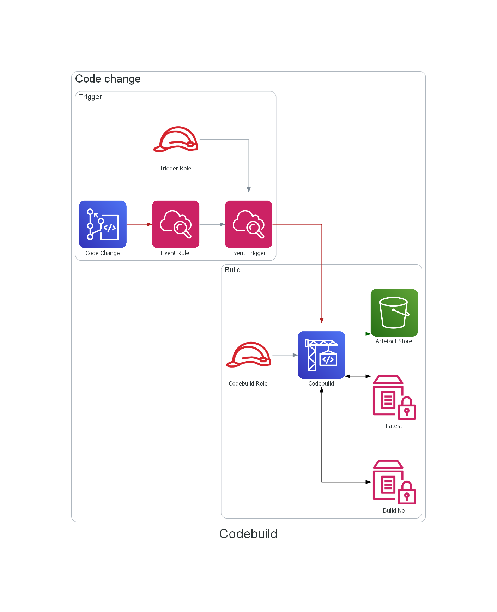

# terraform-aws-codebuild

[](https://github.com/JamesWoolfenden/terraform-aws-codebuild)
[](https://github.com/JamesWoolfenden/terraform-aws-codebuild/releases/latest)
[](https://github.com/JamesWoolfenden/terraform-aws-codebuild/releases/latest)

[](https://github.com/pre-commit/pre-commit)

Terraform module to provision an AWS [`codebuild`](https://aws.amazon.com/codebuild/) CI/CD system.

When to use Codebuild:
If you want to stay with AWS, or when you are using ECR, Codepipeline or CodeCommit.

---



It's 100% Open Source and licensed under the [APACHE2](LICENSE).

## Usage

Include this repository as a module in your existing Terraform code:

```hcl
module "codebuild" {
  source                 = "jameswoolfenden/codebuild/aws"
  version                = "0.2.70"
  description            = var.description
  force_artifact_destroy = var.force_artifact_destroy
  name                   = var.name
  projectroot            = var.projectroot
  sourcecode             = var.sourcecode
}
```

As always a full example is included for reference.

## Testing

Every version of this module is built in Terraform using the the example **examplea** using Github Actions. It 100% has worked.
See the successes and failures here: <https://github.com/JamesWoolfenden/terraform-aws-codebuild/actions>

## Detailed Notes

These templates implement the module terraform-aws-codebuild. It includes a number of defaulted behaviours.

### Sample buildspec files

In the root directory there is an example `buildspec.yml`. This is a build specification you can supply to CodeCommit. It includes some basic codebuild functionality to drive semantic versioning using SSM parameters.

<!-- BEGINNING OF PRE-COMMIT-TERRAFORM DOCS HOOK -->
## Requirements

No requirements.

## Providers

| Name | Version |
| ---- | ------- |
| <a name="provider_aws"></a> [aws](#provider\_aws) | n/a |

## Modules

No modules.

## Resources

| Name | Type |
| ---- | ---- |
| [aws_cloudwatch_event_rule.codechange](https://registry.terraform.io/providers/hashicorp/aws/latest/docs/resources/cloudwatch_event_rule) | resource |
| [aws_cloudwatch_event_target.triggerbuild](https://registry.terraform.io/providers/hashicorp/aws/latest/docs/resources/cloudwatch_event_target) | resource |
| [aws_codebuild_project.build](https://registry.terraform.io/providers/hashicorp/aws/latest/docs/resources/codebuild_project) | resource |
| [aws_iam_policy.trigger](https://registry.terraform.io/providers/hashicorp/aws/latest/docs/resources/iam_policy) | resource |
| [aws_iam_role.codebuild](https://registry.terraform.io/providers/hashicorp/aws/latest/docs/resources/iam_role) | resource |
| [aws_iam_role.trigger](https://registry.terraform.io/providers/hashicorp/aws/latest/docs/resources/iam_role) | resource |
| [aws_iam_role_policy.codebuild](https://registry.terraform.io/providers/hashicorp/aws/latest/docs/resources/iam_role_policy) | resource |
| [aws_iam_role_policy.codecommit](https://registry.terraform.io/providers/hashicorp/aws/latest/docs/resources/iam_role_policy) | resource |
| [aws_iam_role_policy_attachment.attachtotriggerrole](https://registry.terraform.io/providers/hashicorp/aws/latest/docs/resources/iam_role_policy_attachment) | resource |
| [aws_s3_bucket.artifacts](https://registry.terraform.io/providers/hashicorp/aws/latest/docs/resources/s3_bucket) | resource |
| [aws_s3_bucket_lifecycle_configuration.pike](https://registry.terraform.io/providers/hashicorp/aws/latest/docs/resources/s3_bucket_lifecycle_configuration) | resource |
| [aws_s3_bucket_logging.artifacts](https://registry.terraform.io/providers/hashicorp/aws/latest/docs/resources/s3_bucket_logging) | resource |
| [aws_s3_bucket_ownership_controls.artifacts](https://registry.terraform.io/providers/hashicorp/aws/latest/docs/resources/s3_bucket_ownership_controls) | resource |
| [aws_s3_bucket_public_access_block.artifacts](https://registry.terraform.io/providers/hashicorp/aws/latest/docs/resources/s3_bucket_public_access_block) | resource |
| [aws_s3_bucket_server_side_encryption_configuration.artifacts](https://registry.terraform.io/providers/hashicorp/aws/latest/docs/resources/s3_bucket_server_side_encryption_configuration) | resource |
| [aws_s3_bucket_versioning.artifacts](https://registry.terraform.io/providers/hashicorp/aws/latest/docs/resources/s3_bucket_versioning) | resource |
| [aws_ssm_parameter.buildnumber](https://registry.terraform.io/providers/hashicorp/aws/latest/docs/resources/ssm_parameter) | resource |
| [aws_ssm_parameter.latest](https://registry.terraform.io/providers/hashicorp/aws/latest/docs/resources/ssm_parameter) | resource |
| [aws_caller_identity.current](https://registry.terraform.io/providers/hashicorp/aws/latest/docs/data-sources/caller_identity) | data source |
| [aws_iam_policy_document.codebuild](https://registry.terraform.io/providers/hashicorp/aws/latest/docs/data-sources/iam_policy_document) | data source |
| [aws_iam_role.existing](https://registry.terraform.io/providers/hashicorp/aws/latest/docs/data-sources/iam_role) | data source |
| [aws_region.current](https://registry.terraform.io/providers/hashicorp/aws/latest/docs/data-sources/region) | data source |

## Inputs

| Name | Description | Type | Default | Required |
| ---- | ----------- | ---- | ------- | :------: |
| <a name="input_artifact"></a> [artifact](#input\_artifact) | Populates the Artifact block | `map(string)` | <pre>{<br/>  "namespace_type": "NONE",<br/>  "packaging": "NONE"<br/>}</pre> | no |
| <a name="input_artifact_expiry"></a> [artifact\_expiry](#input\_artifact\_expiry) | The number of days after which build artifacts expire from the artifact bucket | `number` | `365` | no |
| <a name="input_artifact_noncurrent_expiry"></a> [artifact\_noncurrent\_expiry](#input\_artifact\_noncurrent\_expiry) | The number of days after which noncurrent (superseded) artifact versions are deleted. Prior versions exist to recover from a bad overwrite, so this is normally much shorter than artifact\_expiry. | `number` | `30` | no |
| <a name="input_artifact_type"></a> [artifact\_type](#input\_artifact\_type) | The Artifact type, S3, CODEPIPELINE or NO\_ARTIFACT | `string` | `"S3"` | no |
| <a name="input_bucketname"></a> [bucketname](#input\_bucketname) | Existing S3 bucket to use for artifacts; leave empty to have this module create one | `string` | `""` | no |
| <a name="input_build_timeout"></a> [build\_timeout](#input\_build\_timeout) | The time to wait for a CodeBuild to complete before timing out in minutes (default: 30) | `number` | `30` | no |
| <a name="input_cache_modes"></a> [cache\_modes](#input\_cache\_modes) | Cache modes used when cache\_type is LOCAL. Ignored for S3 and NO\_CACHE. | `list(string)` | <pre>[<br/>  "LOCAL_SOURCE_CACHE",<br/>  "LOCAL_CUSTOM_CACHE"<br/>]</pre> | no |
| <a name="input_cache_type"></a> [cache\_type](#input\_cache\_type) | CodeBuild cache type: LOCAL, S3 or NO\_CACHE | `string` | `"LOCAL"` | no |
| <a name="input_defaultbranch"></a> [defaultbranch](#input\_defaultbranch) | The default git branch | `string` | `"master"` | no |
| <a name="input_description"></a> [description](#input\_description) | The description applied to the CodeBuild project | `string` | `""` | no |
| <a name="input_encryption_disabled"></a> [encryption\_disabled](#input\_encryption\_disabled) | Disable the encryption of artifacts | `bool` | `false` | no |
| <a name="input_environment"></a> [environment](#input\_environment) | A map to describe the build environment and populate the environment block | `map(any)` | <pre>{<br/>  "compute_type": "BUILD_GENERAL1_SMALL",<br/>  "image": "aws/codebuild/standard:7.0",<br/>  "privileged_mode": "false",<br/>  "type": "LINUX_CONTAINER"<br/>}</pre> | no |
| <a name="input_force_artifact_destroy"></a> [force\_artifact\_destroy](#input\_force\_artifact\_destroy) | Force the removal of the artifact S3 bucket on destroy (default: false). | `bool` | `false` | no |
| <a name="input_kms_key_id"></a> [kms\_key\_id](#input\_kms\_key\_id) | Your Custom KMS key | `string` | `""` | no |
| <a name="input_logs_bucket"></a> [logs\_bucket](#input\_logs\_bucket) | The bucket id and path for storing the logs. This bucket also receives S3 server access logs for the artifact bucket, so it must not be encrypted with SSE-KMS unless a bucket key is enabled — S3 log delivery cannot write to an SSE-KMS bucket without one. | `string` | n/a | yes |
| <a name="input_mfa_delete"></a> [mfa\_delete](#input\_mfa\_delete) | Require MFA to delete | `string` | `"Disabled"` | no |
| <a name="input_name"></a> [name](#input\_name) | The name of the Build | `string` | n/a | yes |
| <a name="input_projectroot"></a> [projectroot](#input\_projectroot) | The name of the parent project for SSM | `string` | `"core"` | no |
| <a name="input_reponame"></a> [reponame](#input\_reponame) | The name of the repository | `string` | `""` | no |
| <a name="input_role"></a> [role](#input\_role) | Override for providing a role | `string` | `""` | no |
| <a name="input_sourcecode"></a> [sourcecode](#input\_sourcecode) | A map to describe where your sourcecode comes from, to fill the sourcecode block in a Codebuild project | `map(any)` | <pre>{<br/>  "buildspec": "",<br/>  "location": "",<br/>  "type": "CODECOMMIT"<br/>}</pre> | no |
| <a name="input_sse_algorithm"></a> [sse\_algorithm](#input\_sse\_algorithm) | The type of encryption algorithm to use | `string` | `"aws:kms"` | no |
| <a name="input_versioning"></a> [versioning](#input\_versioning) | Set bucket to version | `string` | `"Enabled"` | no |

## Outputs

| Name | Description |
| ---- | ----------- |
| <a name="output_artifact_bucket"></a> [artifact\_bucket](#output\_artifact\_bucket) | The Bucket for Artifacts |
| <a name="output_codebuild_role_name"></a> [codebuild\_role\_name](#output\_codebuild\_role\_name) | The name of the IAM role CodeBuild assumes, either the role created by this module or the override supplied in var.role |
| <a name="output_project"></a> [project](#output\_project) | The full aws\_codebuild\_project resource, exposed so callers can reference its arn, id, and badge\_url |
<!-- END OF PRE-COMMIT-TERRAFORM DOCS HOOK -->

## Policy Requirement

<!-- BEGINNING OF PRE-COMMIT-PIKE DOCS HOOK -->
The Terraform resource required is:

```golang
# apply role — full permissions for terraform apply
resource "aws_iam_policy" "terraform_pike" {
  name_prefix = "terraform_pike"
  path        = "/"
  description = "Pike Autogenerated policy from IAC"

  policy = jsonencode({
    "Version": "2012-10-17",
    "Statement": [
        {
            "Sid": "VisualEditor0",
            "Effect": "Allow",
            "Action": [
                "codebuild:BatchGetProjects",
                "codebuild:CreateProject",
                "codebuild:DeleteProject",
                "codebuild:UpdateProject"
            ],
            "Resource": [
                "*"
            ]
        },
        {
            "Sid": "VisualEditor1",
            "Effect": "Allow",
            "Action": [
                "events:DeleteRule",
                "events:DescribeRule",
                "events:ListTagsForResource",
                "events:ListTargetsByRule",
                "events:PutRule",
                "events:PutTargets",
                "events:RemoveTargets"
            ],
            "Resource": [
                "*"
            ]
        },
        {
            "Sid": "VisualEditor2",
            "Effect": "Allow",
            "Action": [
                "iam:AttachRolePolicy",
                "iam:CreatePolicy",
                "iam:CreateRole",
                "iam:DeletePolicy",
                "iam:DeleteRole",
                "iam:DeleteRolePolicy",
                "iam:DetachRolePolicy",
                "iam:GetPolicy",
                "iam:GetPolicyVersion",
                "iam:GetRole",
                "iam:GetRolePolicy",
                "iam:ListAttachedRolePolicies",
                "iam:ListInstanceProfilesForRole",
                "iam:ListPolicyVersions",
                "iam:ListRolePolicies",
                "iam:PassRole",
                "iam:PutRolePolicy"
            ],
            "Resource": [
                "*"
            ]
        },
        {
            "Sid": "VisualEditor3",
            "Effect": "Allow",
            "Action": [
                "kms:Decrypt"
            ],
            "Resource": [
                "*"
            ]
        },
        {
            "Sid": "VisualEditor4",
            "Effect": "Allow",
            "Action": [
                "s3:CreateBucket",
                "s3:DeleteBucket",
                "s3:GetAccelerateConfiguration",
                "s3:GetBucketAcl",
                "s3:GetBucketCORS",
                "s3:GetBucketLogging",
                "s3:GetBucketObjectLockConfiguration",
                "s3:GetBucketOwnershipControls",
                "s3:GetBucketPolicy",
                "s3:GetBucketPublicAccessBlock",
                "s3:GetBucketRequestPayment",
                "s3:GetBucketTagging",
                "s3:GetBucketVersioning",
                "s3:GetBucketWebsite",
                "s3:GetEncryptionConfiguration",
                "s3:GetLifecycleConfiguration",
                "s3:GetObject",
                "s3:GetObjectAcl",
                "s3:GetReplicationConfiguration",
                "s3:ListBucket",
                "s3:PutBucketLogging",
                "s3:PutBucketOwnershipControls",
                "s3:PutBucketPublicAccessBlock",
                "s3:PutBucketVersioning",
                "s3:PutEncryptionConfiguration",
                "s3:PutLifecycleConfiguration"
            ],
            "Resource": [
                "*"
            ]
        },
        {
            "Sid": "VisualEditor5",
            "Effect": "Allow",
            "Action": [
                "ssm:AddTagsToResource",
                "ssm:DeleteParameter",
                "ssm:DescribeParameters",
                "ssm:GetParameter",
                "ssm:GetParameters",
                "ssm:ListTagsForResource",
                "ssm:PutParameter"
            ],
            "Resource": [
                "*"
            ]
        }
    ]
})
}

# plan role — read-only permissions for terraform plan
resource "aws_iam_policy" "terraform_pike_plan" {
  name_prefix = "terraform_pike_plan"
  path        = "/"
  description = "Pike Autogenerated policy from IAC"

  policy = jsonencode({
    "Version": "2012-10-17",
    "Statement": [
        {
            "Sid": "VisualEditor0",
            "Effect": "Allow",
            "Action": [
                "iam:GetRole"
            ],
            "Resource": [
                "*"
            ]
        },
        {
            "Sid": "VisualEditor1",
            "Effect": "Allow",
            "Action": [
                "kms:Decrypt"
            ],
            "Resource": [
                "*"
            ]
        },
        {
            "Sid": "VisualEditor2",
            "Effect": "Allow",
            "Action": [
                "s3:GetAccelerateConfiguration",
                "s3:GetBucketAcl",
                "s3:GetBucketCORS",
                "s3:GetBucketLogging",
                "s3:GetBucketObjectLockConfiguration",
                "s3:GetBucketPolicy",
                "s3:GetBucketRequestPayment",
                "s3:GetBucketTagging",
                "s3:GetBucketVersioning",
                "s3:GetBucketWebsite",
                "s3:GetEncryptionConfiguration",
                "s3:GetLifecycleConfiguration",
                "s3:GetObject",
                "s3:GetObjectAcl",
                "s3:GetReplicationConfiguration",
                "s3:ListBucket"
            ],
            "Resource": [
                "*"
            ]
        }
    ]
})
}


```
<!-- END OF PRE-COMMIT-PIKE DOCS HOOK -->

## Related Projects

Check out these related projects.

- [terraform-aws-codecommit](https://github.com/jameswoolfenden/terraform-aws-codebuild) - Storing ones code

## Help

**Got a question?**

File a GitHub [issue](https://github.com/jameswoolfenden/terraform-aws-codebuild/issues).

## Contributing

### Bug Reports & Feature Requests

Please use the [issue tracker](https://github.com/jameswoolfenden/terraform-aws-codebuild/issues) to report any bugs or file feature requests.

## Copyrights

Copyright © 2019-2026 James Woolfenden

## License

[](https://opensource.org/licenses/Apache-2.0)

See [LICENSE](LICENSE) for full details.

Licensed to the Apache Software Foundation (ASF) under one
or more contributor license agreements. See the NOTICE file
distributed with this work for additional information
regarding copyright ownership. The ASF licenses this file
to you under the Apache License, Version 2.0 (the
"License"); you may not use this file except in compliance
with the License. You may obtain a copy of the License at

<https://www.apache.org/licenses/LICENSE-2.0>

Unless required by applicable law or agreed to in writing,
software distributed under the License is distributed on an
"AS IS" BASIS, WITHOUT WARRANTIES OR CONDITIONS OF ANY
KIND, either express or implied. See the License for the
specific language governing permissions and limitations
under the License.

### Contributors

[![James Woolfenden][jameswoolfenden_avatar]][jameswoolfenden_homepage]<br/>[James Woolfenden][jameswoolfenden_homepage]

[jameswoolfenden_homepage]: https://github.com/jameswoolfenden
[jameswoolfenden_avatar]: https://github.com/jameswoolfenden.png?size=150
